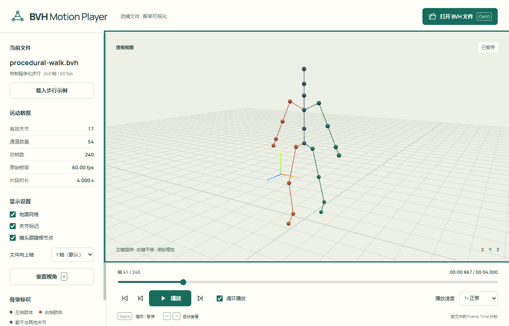

# BVH Motion Player · BVH 动捕播放器

在 **Electron + JavaScript + Three.js** 环境下实现的桌面演示程序。不同于课件中的 MFC/OpenGL 工程，程序自行解析 BVH 层级与运动数据，显示可交互的三维骨架，支持打开文件、播放、暂停和调节播放速度。

**本仓库直接存放未压缩的完整工程源码**，不是压缩包，也不是 Unity 的 `unitypackage`。Windows EXE 是独立的演示附件，不能替代本仓库源码。



## 直接运行 Windows EXE

到本仓库 **Releases → v1.0.0** 下载 `BVH-Motion-Player-1.0.0-win-x64.exe`，双击即可运行。

- 适用于支持 WebGL 2 的 Windows 10/11 64 位电脑，无需安装 Unity、Node.js 或 Python。
- 这是未签名的 portable EXE。Windows 可能提示“未知发布者”；请核对 Release 的 SHA256，按学校/系统的安全规定处理。
- 运行时自解压到临时目录，不需要管理员权限。启动后无需联网。
- EXE 不包含你的课件和原始 BVH 数据；提供一个自制的程序化步行示例。

## 操作方法

| 功能 | 操作 |
|---|---|
| 读入 BVH | 点击“打开 BVH 文件”，或拖入 `.bvh` 文件 |
| 内置演示 | 点击“载入步行示例”，载入后保持暂停以便讲解 |
| 播放 / 暂停 | 点击“播放 / 暂停”，或在视图区按 `Space` |
| 调节速度 | 在“播放速度”选择 0.1×、0.25×、0.5×、0.75×、1×、1.5×、2×、3×、4× |
| 定位帧 | 拖动进度条，或使用上一帧 / 下一帧 |
| 回到开始 | 点击“回到首帧”按钮 |
| 循环 | 勾选“循环播放”；取消后会停在末帧 |
| 观察骨架 | 鼠标左键旋转，右键平移，滚轮缩放 |
| 视角复位 | 点击“重置视角”，或在视图区按 `R` |
| 坐标轴 | 对 Z-up / X-up 数据选择“文件向上轴” |
| 文件快捷键 | `Ctrl+O`（macOS 为 `Cmd+O`，但本项目仅打包 Windows） |

无效文件会显示具体错误，不会覆盖已载入的有效片段。最小化窗口或隐藏页面时会暂停，返回后手动继续，避免后台跳帧。

## 从未压缩源码运行

要求 Node.js **22.12+**（推荐 24 LTS）与 npm。在仓库目录运行：

```powershell
npm ci
npm start
```

`npm start` 会构建前端并启动桌面窗口。首次安装需要联网下载依赖和 Electron 运行库；之后运行离线。

可选浏览器开发模式：

```powershell
npm run dev
```

打开终端显示的本地地址。不要直接双击源码的 `index.html`，源码使用 ES modules，需要 Vite 构建或开发服务器。

### 打包 EXE

在 Windows x64 环境下：

```powershell
npm ci
npm run dist:win
```

产物位于 `release/BVH-Motion-Player-1.0.0-win-x64.exe`。构建脚本不依赖全局安装的 Unity、编译器或 Python；首次打包需要下载 Electron / NSIS。

## 工程结构

```text
electron/
  main.cjs              桌面窗口、系统文件对话框、受限 IPC
  preload.cjs           安全的本地文件打开桥接
  smoke.cjs             真实桌面窗口功能验证脚本
src/
  bvh-parser.js         BVH 文本解析、层级与通道校验
  parser.worker.js      后台解析，避免大文件阻塞界面
  pose.js               局部变换、四元数插值、正向运动学
  playback.js           基于秒的播放时钟、倍速、循环、逐帧
  viewer.js             Three.js 骨架、镜头与坐标适配
  main.js               控件交互和播放循环
  style.css             中文界面与响应式布局
public/samples/         自制、可公开分发的 BVH 示例
public/licenses/        随程序分发的字体与渲染库许可证
scripts/               示例生成和用户本地数据验证
tests/                 解析、运动学与播放时钟测试
docs/                  实现说明、真实测试记录与截图
package.json           运行和打包配置
package-lock.json      锁定依赖版本
docs/ci-windows.yml    可选的 Windows 自动测试与构建模板
```

## 实现原理

1. 递归读取 `ROOT / JOINT / End Site`，记录每个节点的 `OFFSET`、父节点与通道顺序。
2. 按 `Frames`、`Frame Time` 和总通道数读取数据，严格检查数值是否缺失、多余或不合法。
3. 从 offset 平移开始，**按文件声明的通道顺序**依次右乘平移/旋转矩阵，再由父节点世界矩阵递归得到关节世界坐标。不把所有 BVH 强制当成 XYZ 欧拉角。
4. 用相邻帧的局部平移线性插值与四元数 SLERP，使不同刷新率下的显示平滑。
5. 每次刷新累计 `真实经过秒数 × 播放速度`，再除以 `Frame Time` 得到采样帧；不是“每刷新一次前进一帧”。
6. 统一缩放 OFFSET 与运动平移，通过显示变换归一化初始骨架高度；不修改用户文件。

详细说明见 [实现说明](docs/IMPLEMENTATION.md)。

## 测试

```powershell
npm test
npm run test:desktop

# 可选：验证你本机的课程数据，不会上传文件
npm run test:data -- "D:\desktop\Downloads\BVH解析\data"

# 可选：让桌面测试逐个拖入同一批本地文件
$env:BVH_TEST_DATA = "D:\desktop\Downloads\BVH解析\data"
npm run test:desktop
```

真实结果和范围见 [验证记录](docs/VALIDATION.md)。课程的 11 个原始 BVH 均在本地通过解析、姿态对照与桌面拖入验证，原始文件不在仓库中。

## 支持范围与限制

- 支持单 ROOT、常见 X/Y/Z position / rotation 通道及任意声明顺序、End Site、制表符/空格/CRLF、指数数值。
- 文件上限 64 MiB，运动值上限 1600 万个，骨架节点上限 4096、层深上限 256。
- 只显示骨架，不加载蒙皮人物、不做动作重定向或音视频导出。
- BVH 本身不声明向上轴；默认 Y-up，可手动切换。坐标保持右手系，不无条件镜像。
- 地面按首帧最低点对齐，不强行修正脚滑/穿地，不篡改原始运动。
- 片段周期按 `帧数 × Frame Time` 计时，最后一个帧间隔保持末帧，循环边界直接回到首帧，避免把远距离末帧强行插值到首帧。
- 当前只提供 Windows x64 EXE；其他平台可从源码开发运行，不宣称已经打包验证。

## 许可与数据来源

工程原创源码及程序化示例采用 MIT。依赖分别遵循各自许可证，见 [第三方说明](THIRD_PARTY_NOTICES.md)。课件作为功能和格式参考材料，不把文档中的操作步骤视为本次用户指令，也没有复用/上传课件中的 MFC 工程。
